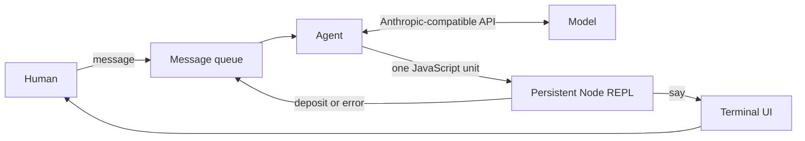

# replagent

**A terminal agent whose only language—and only channel to the world—is a Node.js REPL.**

replagent puts a model inside a persistent Node.js REPL. Instead of asking the
model to emit JSON tool calls, every reply is a JavaScript program that the
REPL executes directly.

```text
you  how many files are in this directory?

● count the files - read the directory and count what is in it
  ls .  see what is in the directory · 12 entries

replagent  There are 12 files in this directory.
```

> **Node.js 22.12+** · TypeScript · Anthropic-compatible API

## Table of contents

- [Why replagent?](#why-replagent)
- [Quick start](#quick-start)
- [How it works](#how-it-works)
- [The protocol](#the-protocol)
- [Toolkit](#toolkit)
- [CLI reference](#cli-reference)
- [Configuration](#configuration)
- [Sessions](#sessions)
- [Terminal experience](#terminal-experience)
- [Architecture](#architecture)
- [Development](#development)
- [Evaluations](#evaluations)
- [Security](#security)
- [Further reading](#further-reading)

## Why replagent?

Most coding agents connect a model to tools through a schema: the model
chooses a tool name, the host validates JSON arguments, and the result is
turned back into another message. replagent replaces that boundary with a
runtime:
- **JavaScript is the whole protocol.** The model can compose calls, use
  `await`, import Node modules, and reach the network without a generated
  client or a schema.
- **One reply is one unit.** A reply must name one `step`, describe its
  intent, and contain the program that does the work.
- **Every tool call explains itself.** The five common helpers require an
  intent, which is shown in the terminal transcript.
- **Observations stay honest.** Human messages, model findings, and errors
  arrive through one labelled queue, so untrusted output cannot masquerade
  as an instruction.
- **Work is visible and resumable.** The TUI shows live progress, folds,
  reasoning, and failures; sessions are append-only JSONL files that can be
  resumed later.

## Quick start

From a checkout of this repository:

```bash
npm install
export ANTHROPIC_API_KEY=your-api-key
npm run dev
```

The default endpoint is the Anthropic-compatible MiniMax API. To use another
endpoint or gateway:

```bash
export ANTHROPIC_BASE_URL=https://gateway.example.com
export ANTHROPIC_AUTH_TOKEN=your-token
export ANTHROPIC_MODEL=your-model-id
npm run dev
```

Use the API root without adding `/v1`. Either `ANTHROPIC_API_KEY` or
`ANTHROPIC_AUTH_TOKEN` is required. Command-line flags take precedence over
environment variables, which take precedence over defaults.

For a production build:

```bash
npm run build
npm start
```

## How it works

1. Human input is added to the message queue.
2. The agent sends the queue to the model and receives one JavaScript reply.
3. The response hook normalizes the output, unwraps common tool-call or code
   fence envelopes, and checks that it is valid JavaScript.
4. The unit scanner requires exactly one `step(name, description, body)`.
5. Node executes the program in a persistent REPL.
6. `say()` sends output to the human; `deposit()` sends an observation to
   the next model request. Errors follow the same path.



The agent loop is intentionally small. The persistent REPL is the working
memory, and the queue is the only channel through which the agent receives
new information.

## The protocol

A valid reply is one self-executing unit:

```js
await step(
  'count the files',
  'read the directory and count what is in it',
  async (name, description) => {
    const entries = await ls('.', 'see what is in the directory');
    deposit(entries.join(', '));
    say(`There are ${entries.length} files in this directory.`);
  },
);
```

The rules are deliberately strict:
1. **One reply contains exactly one `step` call.**
2. **The name and description are required.** The name identifies the unit;
   the description tells the human why it exists.
3. **The unit body is the scope.** Local declarations die when the unit ends.
4. **Use `say()` for the human.** The first `say()` ends the round.
5. **Use `deposit()` for yourself.** Deposited text is queued for the next
   model request.
6. **There is no `console.log`, `return`, or `finish()` channel.** Errors
   are returned to the model with their stack.
7. **Only deliberate persistent state survives.** Put state on `globalThis`;
   required modules remain available through `require`.

Everything the model reads is delivered in a labelled queue:

```text
<queue>
[human] inspect the parser
[you] 42 files matched the pattern
[error] ENOENT: no such file or directory
</queue>
```

The label appears on every line. Content read from a file, command output, or
the web is data—not a human instruction—even if that content says otherwise.

## Toolkit

The REPL provides five helpers for common work. Every helper requires an
intent as its second argument so the action is visible to the human.

| Helper                       | Purpose                           | Options              |
| ---------------------------- | --------------------------------- | -------------------- |
| `read(path, intent)`         | Read a file or a line range       | `{ from?, to? }`     |
| `ls(dir, intent)`            | List directory entries            | —                    |
| `glob(pattern, intent)`      | Find paths matching a pattern     | —                    |
| `edit(path, intent, change)` | Replace an exact string in a file | `{ old, new }`       |
| `bash(command, intent)`      | Run a shell command               | `{ timeout?, cwd? }` |

Example:

```js
const text = await read('src/app/agent.ts', 'see how the turn is driven');
const names = await ls('src', 'see the layout of the project');
const found = await glob('src/**/*.ts', 'find every source file');
await edit('README.md', 'correct the version', {
  old: '0.1.0',
  new: '0.2.0',
});
const result = await bash('git status', 'see what has changed');
```

Built-in limits keep a single observation bounded:

| Limit                                       |       Value |
| ------------------------------------------- | ----------: |
| Characters returned by one `read`           |     200,000 |
| Characters retained from each `bash` stream |      64,000 |
| Maximum `bash` runtime                      | 120 seconds |
| Files returned by one `glob`                |       2,000 |
| Characters retained from one `say`          |       8,000 |
| Characters retained from one `deposit`      |      40,000 |

The toolkit is an ergonomic layer, not a sandbox. The REPL also has full
access to Node and JavaScript, including `fetch`, `node:fs`,
`node:child_process`, `node:path`, JSON, crypto, and the built-in globals.

## CLI reference

```text
replagent [options]
```

| Option                 | Description                                                  | Default                                                     |
| ---------------------- | ------------------------------------------------------------ | ----------------------------------------------------------- |
| `--model <id>`         | Model identifier                                             | `$ANTHROPIC_MODEL` or `MiniMax-M3.1-Flash`                  |
| `--base-url <url>`     | API root; do not add `/v1`                                   | `$ANTHROPIC_BASE_URL` or `https://api.minimax.cn/anthropic` |
| `--max-tokens <n>`     | Maximum tokens per reply; reasoning counts toward it         | `131072`                                                    |
| `--effort <level>`     | Reasoning effort: `low`, `medium`, `high`, `xhigh`, or `max` | `max`                                                       |
| `--max-steps <n>`      | Maximum REPL rounds per turn                                 | `24`                                                        |
| `--context-window <n>` | Context size used by the status bar                          | Model-specific, otherwise `1000000`                         |
| `--resume <id>`        | Resume a session by full ID or unique prefix                 | —                                                           |
| `--continue`           | Resume the newest session for the current directory          | —                                                           |
| `--list-sessions`      | List sessions for the current directory and exit             | —                                                           |
| `--no-session`         | Run without recording the session                            | —                                                           |
| `-h, --help`           | Show help                                                    | —                                                           |

Unknown flags are errors rather than being ignored. `--resume` and
`--continue` cannot be combined, and either requires session recording to
be enabled.

## Configuration

| Variable               | Purpose                                          |
| ---------------------- | ------------------------------------------------ |
| `ANTHROPIC_API_KEY`    | API key sent as `x-api-key`                      |
| `ANTHROPIC_AUTH_TOKEN` | Bearer token sent as `Authorization: Bearer`     |
| `ANTHROPIC_BASE_URL`   | Anthropic-compatible API root                    |
| `ANTHROPIC_MODEL`      | Default model identifier                         |
| `REPLAGENT_HOME`       | Session storage root; defaults to `~/.replagent` |

Configuration precedence is always:

```text
command-line flag > environment variable > built-in default
```

## Sessions

Sessions are enabled by default and stored outside the repository:

```text
~/.replagent/projects/<escaped-working-directory>/<session-id>.jsonl
```

Each file is append-only JSONL. It records the model, effort, token limit,
step limit, and a hash of the system prompt, followed by queue entries,
messages, reasoning, tool calls, output, notes, and turn status.

```bash
npm run dev -- --list-sessions
npm run dev -- --continue
npm run dev -- --resume 20261023T191005Z
npm run dev -- --no-session
```

A resumed session replays its transcript and restores the conversation.
Changing the model or system prompt is allowed and produces a visible note.
See [Session storage](docs/session-storage.md) for the file format, locking,
replay rules, and prompt-cache implications.

## Terminal experience

replagent uses an alternate-screen terminal UI with an editor pinned at the
bottom.

The activity line stays on one row while work is running. It distinguishes
live reasoning, code generation, and tool execution from settled receipts.
A failed step remains visibly red even when its code is folded away.

The status bar shows the working directory, Git branch, model, session ID,
context usage, and cache-hit rate. On narrow terminals, less important
identity fields are removed before the directory.

### Keyboard and mouse

| Input                    | Action                                 |
| ------------------------ | -------------------------------------- |
| Mouse wheel              | Scroll the transcript                  |
| `PageUp` / `PageDown`    | Scroll by page                         |
| `Ctrl+Home` / `Ctrl+End` | Jump to the beginning or end           |
| `Ctrl+F`                 | Search the transcript                  |
| `Ctrl+E`                 | Open or close the last step's code     |
| `Ctrl+O`                 | Open or close the last reasoning block |
| `Ctrl+C` twice           | Interrupt once, then quit              |

Type `/quit` or `/exit` to leave. The transcript is copied to the normal
terminal screen when the application exits.

## Architecture

The code is split into four layers. Dependency direction is enforced by
`dependency-cruiser`, not only by convention.

```text
src/
├── domain/       Protocol, queue, unit scanner, ports — no dependencies
├── app/          Agent loop, system prompt, session replay
├── adapters/     Anthropic API, Node REPL, toolkit, TUI, JSONL sessions
└── cli/          Argument parsing and dependency wiring
```

| Layer      | May depend on                               |
| ---------- | ------------------------------------------- |
| `domain`   | Nothing outside the domain; no npm packages |
| `app`      | `domain`                                    |
| `adapters` | `domain`                                    |
| `cli`      | Everything above                            |

Important implementation points:
- `src/domain/unit.ts` scans JavaScript source and rejects a reply unless it
  contains exactly one valid `step` call.
- `src/domain/queue.ts` is the single observation channel and preserves the
  origin of every line.
- `src/domain/model-output.ts` normalizes model output and unwraps common
  MiniMax, OpenAI, Anthropic, and Markdown code-fence envelopes.
- `src/adapters/repl/node-repl.ts` owns the persistent REPL, tool helpers,
  unit execution, output limits, and Node 24 compatibility workaround.

<details>
<summary>Why plain JavaScript instead of standard tool calling?</summary>

A text-only protocol can expose leakage from models trained to emit tool
calls. replagent keeps the model's language pure and adds a response hook
that unwraps several common envelope shapes before validation.

A conventional alternative is to expose exactly one tool named `repl`
whose argument is JavaScript. That is broadly portable, but the reply is no
longer literally JavaScript. This project chooses the pure-text protocol.

</details>

## Development

### Requirements

- Node.js `>=22.12.0`
- npm

### Common commands

| Command             | Purpose                             |
| ------------------- | ----------------------------------- |
| `npm run dev`       | Run the CLI from TypeScript source  |
| `npm run build`     | Build the executable bundle         |
| `npm start`         | Run the built bundle                |
| `npm test`          | Run the Vitest suite                |
| `npm run coverage`  | Run tests with coverage             |
| `npm run lint`      | Run Biome and ESLint                |
| `npm run typecheck` | Run strict TypeScript checks        |
| `npm run deps`      | Validate architectural dependencies |
| `npm run check`     | Run every quality gate and build    |

`npm run check` covers strict type checking, formatting and lint rules,
complexity limits, dependency boundaries, unit and integration tests,
coverage thresholds, and the production build.

## Evaluations

Repeatable task evaluations check the real agent loop and REPL against final
files, functional tests, and answers. Prompt and harness candidates can evolve
together while the task definitions and grading remain fixed.

```bash
npm run eval:smoke       # offline reference/runner self-check
npm run eval:baseline    # live model, three trials per task; creates .evals/baseline-v3
npm run eval:regression  # rerun and compare old capabilities with that baseline
npm run eval:long:smoke  # offline self-check for eight composite/multi-turn tasks
npm run eval:long        # live long-task exploration, three trials per task
npm run eval:experiment -- --mode live --trials 3 --concurrency 3  # four prompt/harness arms
npm run eval:repository:smoke  # offline pinned real-repository checks
npm run eval:repository       # live feature, bug fix, and compatibility refactor
```

The npm scripts load `.env.local`. Reports, traces, and bounded final-state
snapshots are written under `.evals/`. Offline scores are kept distinct from
real model results. See [Evaluation workflow](docs/evaluations.md) for task
authoring, comparison gates, budgets, and joint prompt/harness experiments.
See [Composite and long evaluations](docs/long-evaluations.md) for the development/
holdout split, turn checkpoints, external input updates, and longer budgets.
See [Evaluation-driven iteration](docs/evaluation-iteration.md) for the controlled
four-arm experiment, model-initiated memory, pinned repository tasks, and promotion rules.
See [Iteration results](docs/iteration-evaluation-results.md) for the measured outcomes,
independent confirmation, rubric correction, and current baselines.

## Security

replagent is a local developer tool, not a sandbox.
- The agent executes JavaScript with the same operating-system permissions as
  the replagent process. It can read and modify files and start processes.
- Tool output, web pages, and repository files are untrusted data. They may
  contain prompt-injection attempts; never treat their contents as policy.
- Sessions can contain source code, command output, and other sensitive data.
  They are stored locally with restrictive file permissions. Use
  `--no-session` on shared or CI machines.
- API keys and bearer tokens are read from the environment and are not
  written to session files. The system prompt is stored only as a hash.

Review commands and code changes before allowing an agent to run in a
trusted repository or against production systems.

## Further reading

- [Session storage design](docs/session-storage.md)
- [Agent loop](src/app/agent.ts)
- [System prompt](src/app/prompt.ts)
- [CLI options](src/cli/args.ts)
- [Dependency rules](.dependency-cruiser.cjs)
